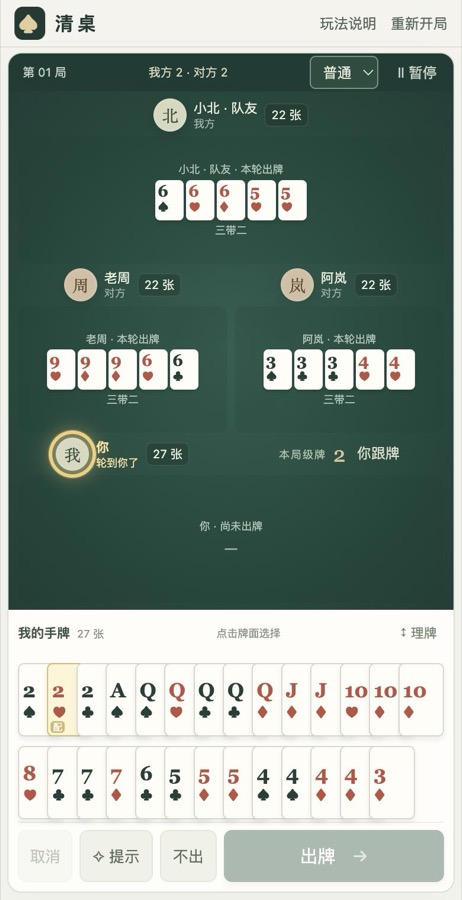

# 清桌 · 掼蛋

[English](README.md) | **简体中文**

轻量单机 Web 掼蛋：一名玩家、三名电脑，对家组队，简单／普通／困难三档随时切换。纯 HTML、CSS、JavaScript，无第三方运行时依赖，无后端、数据库、账号和外部 API。

手机优先：竖屏双排手牌、横屏牌桌与手牌左右分栏，常见手机尺寸整局一屏；支持滑动选牌。

<p align="center"></p>

## 本地运行

需要一个静态 HTTP 服务（ES modules / Web Worker 不支持直接双击 `file://` 打开）。例如 Python 3：

```sh
python3 -m http.server 8080 --bind 127.0.0.1
```

浏览器打开 `http://127.0.0.1:8080`。也可用任何静态 Web 服务器。不需要 `npm install`。

## 玩什么

- 两副牌 108 张，四人各 27 张；玩家与对面电脑“小北”组队。
- 单张、对子、三张、三带二、顺子、三连对、钢板、炸弹、同花顺、天王炸。
- 级牌、红心级牌配牌、接风、名次升级、过 A、单贡／双贡／抗贡／还贡。
- 每个座位显示最近一手出的牌；选择“不出”时清空自己的出牌区并显示“不出”。已出完玩家的最后一手在被压过或本轮结束后消失。只有当前出牌人的头像高亮。
- 点击或滑动选牌、提示（重复点击换建议）、理牌、暂停、重新开局、局末结算。支持键盘 Enter / H / P / Esc。
- 当前牌局和难度自动保存于当前浏览器，刷新继续。无跨设备同步。

本作采用一套固定休闲规则，细节见游戏内“玩法说明”和 [规则说明](docs/rules.zh-CN.md)，不宣称覆盖所有地区变体。

## 电脑难度

- **简单**：基础启发式，在合法出牌中大致随机选择。
- **普通**：先把整手牌拆成手数最少的组合，每一步按“出完后剩余手牌的质量 + 这一轮的牌权价值”选择。会用最小的控制牌抢牌权，只在最后收尾时先出控制牌，看准时机才用炸弹，队友领先时不接，给快走完的队友递牌。
- **困难**：在普通基础上记牌、根据对手“不出”推断，残局时把未见的牌按剩余张数随机发给其他三家，逐个候选模拟打完，选平均结果最好的出法。

三档都不读取其他玩家的隐藏手牌。电脑在 Web Worker 中计算，异常或超时会退回普通策略。

## 部署到自己的服务器

```sh
sh deploy/package.sh
```

生成 `dist/` 和 `release/guandan-web.zip`。**只需上传 dist 内的文件**到网站根目录，或解压 ZIP 到该目录。服务器不需要 Node、Python、数据库或构建过程。所有资源使用相对路径，也可部署到 `https://example.com/guandan/`（保留尾部 `/`）。Nginx 与 Docker 示例见 [部署说明](docs/deployment.zh-CN.md)。

## 开发与验证

开发测试需要 Node.js 18+，不需要安装 npm 依赖：

```sh
npm test
```

测试覆盖牌型、百搭限制、炸弹优先级、接风、过 A、进贡还贡、三档完整牌局模拟、牌守恒、存档恢复和电脑出牌的典型局面。

电脑自我对战评测（同一副牌交换座位各打一次）：

```sh
node tests/bench.mjs 200 hard normal
```

## 文件结构

- `index.html`、`styles.css`：牌桌和响应式界面。
- `js/rules.js`：纯函数牌型识别、合法出牌生成与比较。
- `js/game.js`：发牌、回合、进贡、名次和升级状态机。
- `js/app.js`：交互、存档和电脑行动调度。
- `js/ai.js`、`js/ai-worker.js`：电脑策略入口与后台线程。
- `js/ai/`：拆牌（decompose）、记牌（tracker）、出牌决策（strategy）、残局模拟（search），以及简单难度用的基础策略（basic）。
- `tests/`：Node 测试、自我对战评测和本地预览页（不包含在部署包）。
- `deploy/`：打包脚本、Nginx 与 Docker 示例。
